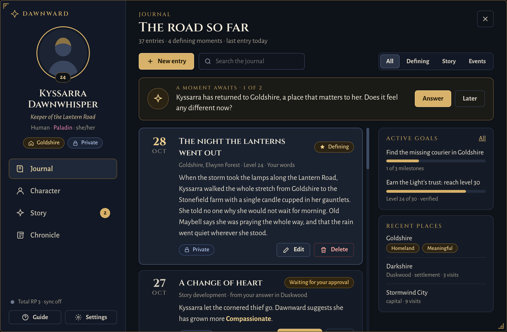
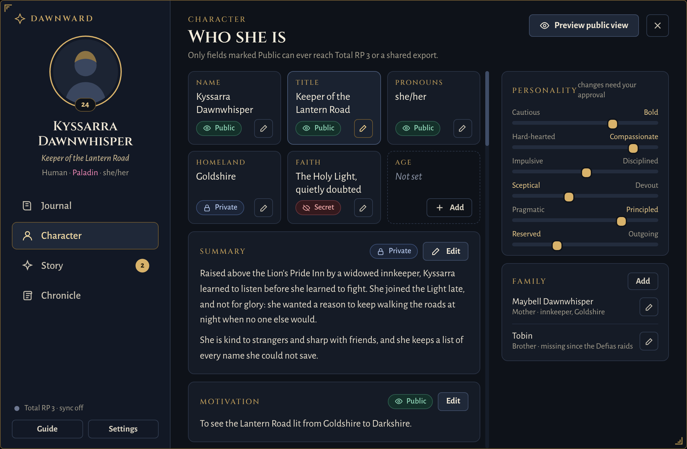
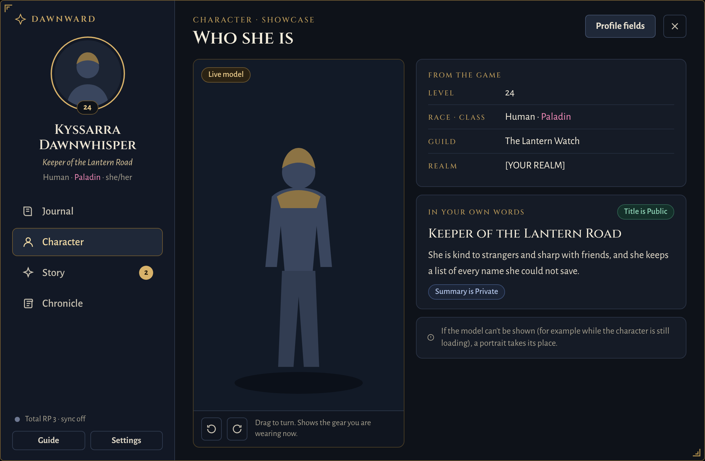
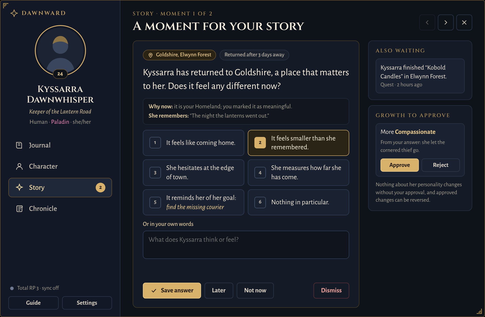
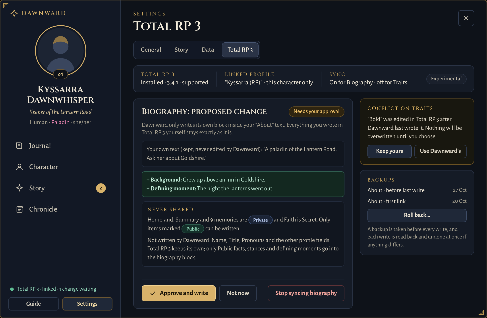
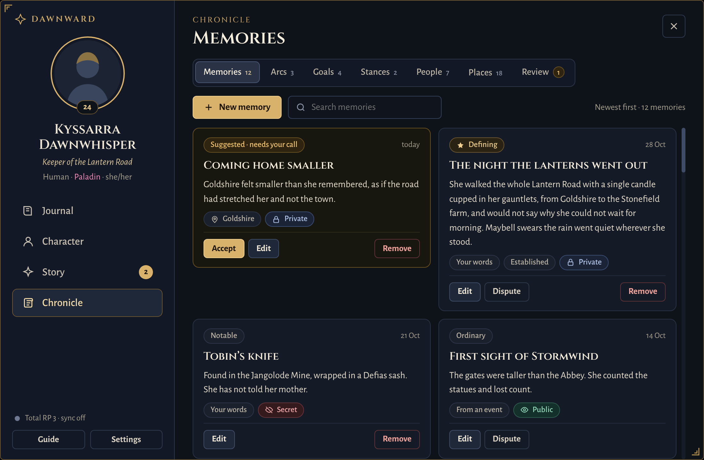
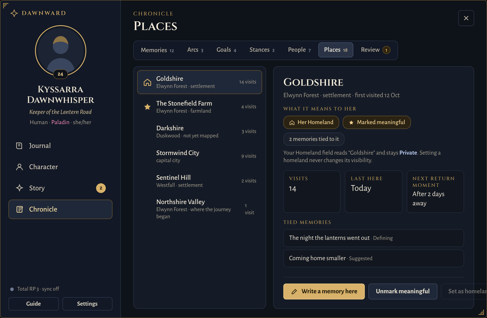
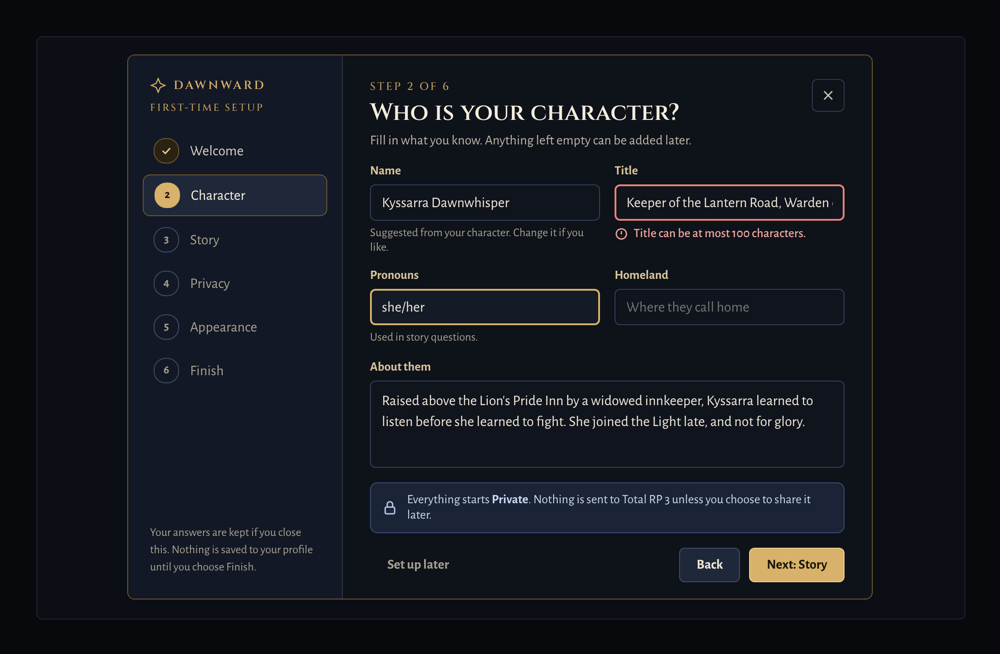
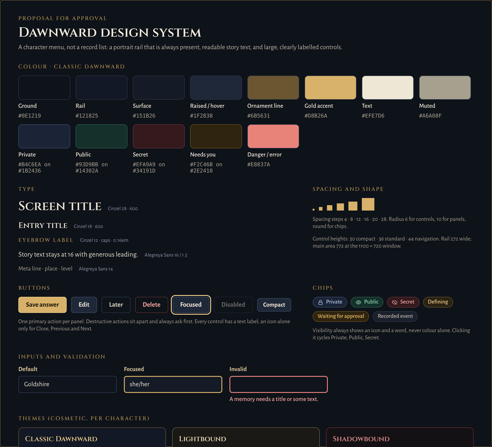

<div align="center">

<picture>
  <source media="(prefers-color-scheme: dark)" srcset="assets/branding/png/dawnward-lockup-dark.png">
  
</picture>

### *A living chronicle for your World of Warcraft character*

**Total RP 3 tells the world who your character is.<br>Dawnward Chronicles helps you discover who they become.**

[Features](#features) · [Previews](#visual-previews-ui-concepts) · [How it works](#how-it-works) · [Install](#installation) · [Getting started](#getting-started) · [Status](#development-status) · [Docs](#documentation)

[](#development-status)
[](docs/COMPATIBILITY.md)
[](docs/COMPATIBILITY.md)
[](LICENSE)

</div>

---

Dawnward Chronicles is a roleplaying companion for World of Warcraft Classic Era. It keeps a living journal of your character: who they are, where they have been, what they remember and what they want. A quiet Story Director notices what your character actually does in the game and, now and then, asks how it affected them. Your answers, never the addon, shape your character over time.

**The problem it solves:** a roleplay profile describes a character at one moment, but characters change through what they live through. Dawnward connects your real adventures (quests, places, levels, close calls) to your character's story, and keeps that story private until you choose to share it.

It works for **every class, race and faction**. Class never decides personality, and nothing assumes your character is heroic, religious or loyal to anyone.

> **Status: pre-alpha, no public release.** The v0.7 interface below is implemented and passes the automated suite, but has **not yet been checked in game**. See [Development status](#development-status).



<sub>**UI concept, not an in-game screenshot.** This is the approved design the in-game interface is built to. The character, entries and places shown are invented sample data for the mockup, not game lore and not anyone's real character. Real screenshots will be added once the interface has been checked in game.</sub>

## Philosophy

**Total RP 3 tells the world who your character is. Dawnward Chronicles helps you discover who they become.**

- **The player is the author.** Nothing changes your character without your approval. You can always postpone, dismiss, edit, reject or reverse.
- **Verified, not invented.** Events record only what the game reports. Dawnward never invents quest plots, places, people, gear or outcomes.
- **Private by default.** Everything you add starts private. Only what you approve and make public can ever leave Dawnward.
- **Time you play, not time away.** Story pacing counts gameplay only. Nothing in your history changes just because time passes.

## Features

### Your own character profile
Dawnward Chronicles includes its own comprehensive character profile and storytelling tools, but it is not intended to replace Total RP 3's established public social roleplaying profile system. Dawnward helps players develop their characters through gameplay, while optional TRP3 integration lets them share approved public information with the broader roleplaying community.

- **Profile:** name, title, pronouns, race, class, age, homeland, faith, occupation, appearance, summary and motivation, grouped into Identity, Background and Summary panels.
- **Every field is Public, Private or Secret.** A public preview shows exactly what others could ever see.
- **Personality:** six axes (Courage, Compassion, Discipline, Faith, Honour, Sociability) that change one step at a time, only when you approve.
- **Family and relationships:** family members, history, and people your character knows (NPCs and other players' characters), with private feelings.

### Character Showcase
Your character's **live 3D model**, in the gear you are actually wearing, rendered by the game itself.
- Turn it with buttons or by dragging, and zoom with the mouse wheel.
- Prefer the portrait? Choose it, and the choice is remembered for that character. The portrait is also used automatically if the model cannot load.
- **What the game says** (level, race, class, guild, realm) is read live and kept apart from **what you wrote** (name, title, pronouns, summary).
- Nothing is rendered while the journal is closed.

### Living journal
- Level-ups, quests and other verified events are recorded with time, place and level.
- Story drafts come from your answers. You can also write your own entries, then edit, approve and mark defining moments.
- Search and filters (All, Defining, Story, Events).
- The dashboard also shows the next moment waiting for you, your active goals and your recent places.

### Story Director
Optional, paced questions at calm moments, never in combat.
- Each moment shows **what happened**, **why it matters** to your character (homeland, a marked place, a memory, an arc, a goal, a person) and the **memories it recalls**.
- **Answering:** choose a response, write your own, keep it for **Later**, say **Not now**, or **Dismiss** it.
- **Personality changes:** proposed changes show why they were suggested. Approve, reject, or reverse them later.

### Gameplay-time progression
Story pacing follows a per-character **narrative clock** that only advances while you play. Logging out, being AFK and changing the computer's clock don't count.
- A **narrative day** is 2 hours of play by default. Choose Brisk (1 hour) or Slow (4 hours) in Settings → Story.
- Returning to a place that matters can become a moment after **one narrative day away**, at most once per place every **seven narrative days**. Crossing a zone border back and forth earns nothing.

### Import your existing story
Paste a backstory you already wrote, or read your Total RP 3 About text (read-only). It is kept word for word, and you approve, edit or skip each sentence before it becomes part of your character (Private by default). Character → Import story, or `/dawnward biography`.

### Memories, goals and arcs
- Memories linked to what happened and where. Suggested memories wait for you to accept or reject them.
- Long-term arcs with turning points, suggested when your answers share a theme.
- Personal goals with milestones and verified progress, such as a level target or a reputation standing.
- Stances (public persona vs private conviction) and a continuity review that flags contradictions for you to settle.

### Places and travel history
- Starting areas, settlements and capitals are recognised from the game's own map data.
- Mark the places that matter, set your Homeland, and write memories tied to a place.
- Places has a list-and-detail view with visits, your last visit, and when a return could next become a moment.

### First-time setup
A six-step guided setup for a new character: Welcome, Character, Story, Privacy, Appearance, Finish.
- It opens by itself only for a genuinely new character.
- Your progress is kept if you close it, and you can rerun it any time from Settings.
- It never publishes anything to Total RP 3.

### Optional Total RP 3 integration
Dawnward works fully without [Total RP 3](https://github.com/Total-RP/Total-RP-3). With it, a **Total RP 3 page** (Settings → Total RP 3, or the status line in the side rail) shows:
- whether TRP3 is installed, its version, and your linked profile;
- the sync status for each feature;
- exactly what would be shared (public only) and the proposed changes;
- conflicts, backups and rollback;
- which TRP3 fields Dawnward never writes.

Sync is **experimental and off by default**. Once you authorise it, it keeps your **Public** information up to date in Total RP 3 by itself:
- **What it can manage:**
  - Dawnward's own biography section and personality traits;
  - Title, Race, Class, Age and Homeland (shown as Birthplace), each with its own setting: managed by Dawnward, managed by Total RP 3 (the default), or not synchronised.
- **Your own values stay yours:** Dawnward writes a field only while it is empty or still holds exactly what Dawnward last wrote. If you or another addon changed it, that field pauses until you choose **Keep yours** or **Use Dawnward's**.
- **Approval:** opt-in per character and per TRP3 profile, after a preview of exactly what would be written; a shared profile is flagged.
- **Safety:** a backup before every write (the state before Dawnward's first write is always kept), and a read-back that undoes the write at once if anything differs.
- **Rollback:** it shows anything no longer Public before restoring, and by default never makes it visible again.
- **Import from TRP3:** always explicit (Private by default).
- **Never written:** first and last name, pronouns, Currently/OOC and the other fields listed on the page.

### Privacy guarantees
- **Private and Secret never leave Dawnward.** They never reach Total RP 3 or a share export.
- **Secret** is left out of your personal backups too, unless you ask for it.
- **Simulation mode** keeps test data apart from your real character.
- **Each character's story is its own.** Story moments start only for a character that has a Dawnward profile.
- **Dawnward never speaks for you.** It never sends chat, emotes or whispers.

## Visual previews (UI concepts)

These are the approved designs the in-game interface is built to. **They are concepts, not screenshots**, and the characters and stories in them are sample data. Approved in-game screenshots will be added alongside or instead of them once the interface has been checked in game.

| Character profile | Character Showcase |
|---|---|
|  |  |
| **Story Director** | **Total RP 3 sync** |
|  |  |
| **Chronicle: Memories** | **Chronicle: Places** |
|  |  |
| **First-time setup** | **Design system** |
|  |  |

The full gallery, with the sources the images were rendered from, is in [`docs/design/mockups`](docs/design/mockups/README.md). The design specification is [`docs/design/UI_DESIGN_V07.md`](docs/design/UI_DESIGN_V07.md).

## How it works

```
  You play            a quest is turned in, a level reached, a place revisited
     |                (only what the game verifiably reports)
     v
  A quiet question    "How did it sit with them?" at a calm moment, never in combat
     |                answer, write your own, keep it for later, or dismiss it
     v
  Your decision       may propose a small personality change (one step on a 0-20 axis)
     |                applied only when you approve it, always reversible
     v
  The journal         a private draft: what happened, where, how they responded
     |
     v
  Your choice         approve it, mark it defining, make it public, and, if you
                      turned sync on, preview and approve it for Total RP 3
```

Two players completing identical content will develop different characters, because the story comes from **their** choices.

## Development status

| Marker | Meaning |
|---|---|
| ✅ **Verified in game** | Passed a recorded in-game check on Classic Era 1.15.9, by the developer |
| 🧪 **Implemented, automated tests** | Code exists and passes the automated suite; not yet checked in game |
| 🚧 **In development** | Being built, or built in part |
| 🗺️ **Planned** | An open issue; not started |
| ⛔ **Blocked** | Waiting on something outside this project, or on a release gate |

Approved designs are listed separately: an approved mockup is a design, not a feature. Automated tests are not in-game verification.

### Feature roadmap

| Feature | What it does | Status |
|---|---|---|
| **Journal window** | `/dawnward` opens the journal: Journal, Character, Story and Chronicle sections | ✅ v0.2 (window); v0.7 layout 🧪 |
| **Character profile** | Name, title, race, class, faith, motivation and more; family and history; every item public, private or secret | ✅ v0.2; v0.7 grouped profile and public preview 🧪 |
| **Automatic milestones** | Level-ups recorded with time and place | ✅ v0.2 |
| **Backups and sharing** | Personal backups (private data, secrets on request) and share exports (public only), with an import undo | ✅ v0.2 |
| **Simulation mode** | Experiment on separate test data; real data is untouched | ✅ v0.2 |
| **Character canon** | Facts and six personality axes (Faith means any belief or worldview, not one religion) | 🧪 v0.3 |
| **Gameplay events** | Quest turn-ins, deaths and level-ups as verified records, never recorded twice | 🧪 v0.4 ([#11](https://github.com/roryherriman/Dawnward-Chronicles/issues/11)) |
| **Story moments** | Universal questions with answers in different directions, your own words, Later / Not now / Dismiss; never in combat | 🧪 v0.4; v0.7 Story Director screen 🧪 ([#14](https://github.com/roryherriman/Dawnward-Chronicles/issues/14), [#25](https://github.com/roryherriman/Dawnward-Chronicles/issues/25)) |
| **Personality evolution** | Answers propose one-step changes that you approve, reject or reverse | ✅ v0.4 (approved changes, owner-tested 2026-10-26) |
| **Living journal** | Story drafts, your own entries, approval, defining moments, search | ✅ v0.4 (journal and memories, owner-tested); v0.7 dashboard 🧪 |
| **TRP3 Chronicle sync** | Dawnward-owned About section and traits from public information only; backup, rollback, conflict and editor protection | 🚧 experimental; opt-in sync, editor protection, backup and rollback ✅ owner-tested on TRP3 3.4.1 ([#4](https://github.com/roryherriman/Dawnward-Chronicles/issues/4), [#5](https://github.com/roryherriman/Dawnward-Chronicles/issues/5), [#6](https://github.com/roryherriman/Dawnward-Chronicles/issues/6)) |
| **TRP3 presentation styles** | Neutral, Silver Hand and Arcane formatting for Dawnward's section | 🧪 v0.4 ([#10](https://github.com/roryherriman/Dawnward-Chronicles/issues/10)) |
| **World events** | First zone visits, dungeon entries, reputation tier changes (observed only), guild membership | 🧪 v0.4 ([#11](https://github.com/roryherriman/Dawnward-Chronicles/issues/11), [#18](https://github.com/roryherriman/Dawnward-Chronicles/issues/18), [#36](https://github.com/roryherriman/Dawnward-Chronicles/issues/36)) |
| **Memories, arcs and goals** | Memories, long-term arcs, personal goals with verified progress, continuity review | ✅ v0.4 (owner-tested 2026-10-26); v0.7 cards 🧪 ([#19](https://github.com/roryherriman/Dawnward-Chronicles/issues/19), [#20](https://github.com/roryherriman/Dawnward-Chronicles/issues/20), [#27](https://github.com/roryherriman/Dawnward-Chronicles/issues/27), [#42](https://github.com/roryherriman/Dawnward-Chronicles/issues/42)) |
| **Identity and people** | Public persona vs private convictions; people your character knows, with private feelings | ✅ v0.4 (owner-tested 2026-10-26) ([#18](https://github.com/roryherriman/Dawnward-Chronicles/issues/18), [#28](https://github.com/roryherriman/Dawnward-Chronicles/issues/28), [#37](https://github.com/roryherriman/Dawnward-Chronicles/issues/37)) |
| **Roleplay moments, timeline, reflection** | Record your own moments, browse a timeline, sit down to reflect | 🚧 v0.4, in part ([#40](https://github.com/roryherriman/Dawnward-Chronicles/issues/40), [#26](https://github.com/roryherriman/Dawnward-Chronicles/issues/26), [#29](https://github.com/roryherriman/Dawnward-Chronicles/issues/29)) |
| **Places and homeland** | Places logged as you travel, meaningful places, Homeland, returns as moments | ✅ v0.4 (Elwynn Forest, Northshire, Goldshire); v0.7 list and detail 🧪 ([#35](https://github.com/roryherriman/Dawnward-Chronicles/issues/35)) |
| **Edit everything in the window** | New and Edit forms for every record; keyboard navigation and inline validation | 🧪 v0.5–v0.6 ([#46](https://github.com/roryherriman/Dawnward-Chronicles/issues/46)) |
| **Guide, help and minimap button** | First-run guide, searchable help, minimap button | 🧪 v0.5 ([#45](https://github.com/roryherriman/Dawnward-Chronicles/issues/45)) |
| **Weighted story moments** | Places ask by how much they matter: homeland, marked places, memories, arcs, goals and people weigh most | 🧪 v0.5 |
| **Zone Atlas** | Each place ID labelled with how it was verified; `/dawnward atlas` checks them | 🚧 the export and scan checks (M17, M18) ✅ in game; coverage in progress ([#48](https://github.com/roryherriman/Dawnward-Chronicles/issues/48)) |
| **Gameplay-time narrative clock** *(new)* | Per-character play time for story pacing; offline and AFK time never count; Brisk, Standard and Slow paces | 🧪 v0.7 |
| **Live 3D Character Showcase** *(new)* | The game's own model of your character in your current gear, with turning, zoom and a portrait choice | 🧪 v0.7 |
| **Modern interface and accessibility** *(new)* | The approved v0.7 design: character rail, cards, chips, bundled fonts, six themes, keyboard navigation, inline validation, scale to fit | 🧪 v0.6–v0.7 ([#17](https://github.com/roryherriman/Dawnward-Chronicles/issues/17)) |
| **First-time setup wizard** *(new)* | Six guided steps for a new character, with drafts you can resume | 🧪 v0.6–v0.7 ([#51](https://github.com/roryherriman/Dawnward-Chronicles/issues/51), [#16](https://github.com/roryherriman/Dawnward-Chronicles/issues/16)) |
| **TRP3 sync management screen** *(new)* | Status, linked profile, public preview, proposed changes, conflicts, backups and rollback on one page; uses the existing guarded sync | 🧪 v0.7 |
| **Automatic TRP3 field sync** *(new)* | Title, Race, Class, Age and Homeland kept up to date from Public values; per-field ownership; conflicts pause; visibility-aware rollback | 🧪 v0.8-dev; multiplayer ⛔ untested ([#7](https://github.com/roryherriman/Dawnward-Chronicles/issues/7), [#15](https://github.com/roryherriman/Dawnward-Chronicles/issues/15)) |
| **Story import** *(new)* | Paste or read your existing backstory; every sentence approved by you before it becomes canon | 🧪 v0.8-dev ([#23](https://github.com/roryherriman/Dawnward-Chronicles/issues/23), [#16](https://github.com/roryherriman/Dawnward-Chronicles/issues/16)) |
| **Context-aware Story Director** *(new)* | Uses your goals, arcs, memories, stances, homeland and standings; recalls earlier answers; no repeated questions; continuity review with examine, explain and undo | 🧪 v0.8-dev ([#20](https://github.com/roryherriman/Dawnward-Chronicles/issues/20), [#25](https://github.com/roryherriman/Dawnward-Chronicles/issues/25), [#42](https://github.com/roryherriman/Dawnward-Chronicles/issues/42)) |
| **Dungeon bosses, relationship graph, scrapbook, letters** | Boss detection, family-tree views, scrapbook and alternate journal formats | 🗺️ [#11](https://github.com/roryherriman/Dawnward-Chronicles/issues/11), [#37](https://github.com/roryherriman/Dawnward-Chronicles/issues/37), [#41](https://github.com/roryherriman/Dawnward-Chronicles/issues/41), [#31](https://github.com/roryherriman/Dawnward-Chronicles/issues/31) |
| **Immersive journal redesign** | The customisable fantasy journal | 🚧 v0.7 design implemented, in-game check pending ([#17](https://github.com/roryherriman/Dawnward-Chronicles/issues/17)) |

### Future work

1. **Current interface and testing:**
   - the in-game checklist for the v0.7 build ([`docs/TESTING.md`](docs/TESTING.md) parts Q to S);
   - in-game screenshots to replace the concepts;
   - [#17](https://github.com/roryherriman/Dawnward-Chronicles/issues/17), [#45](https://github.com/roryherriman/Dawnward-Chronicles/issues/45), [#46](https://github.com/roryherriman/Dawnward-Chronicles/issues/46), [#51](https://github.com/roryherriman/Dawnward-Chronicles/issues/51), [#14](https://github.com/roryherriman/Dawnward-Chronicles/issues/14).
2. **TRP3 integration:**
   - in-game checks of the new Total RP 3 page;
   - presentation themes and import: [#10](https://github.com/roryherriman/Dawnward-Chronicles/issues/10), [#4](https://github.com/roryherriman/Dawnward-Chronicles/issues/4), [#5](https://github.com/roryherriman/Dawnward-Chronicles/issues/5), [#6](https://github.com/roryherriman/Dawnward-Chronicles/issues/6), [#16](https://github.com/roryherriman/Dawnward-Chronicles/issues/16), [#23](https://github.com/roryherriman/Dawnward-Chronicles/issues/23);
   - ⛔ multiplayer propagation and upstream setters: [#7](https://github.com/roryherriman/Dawnward-Chronicles/issues/7), [#8](https://github.com/roryherriman/Dawnward-Chronicles/issues/8).
3. **Story Director and narrative systems:**
   - richer context: reputation and stances in prompts;
   - boss and encounter events;
   - [#11](https://github.com/roryherriman/Dawnward-Chronicles/issues/11), [#20](https://github.com/roryherriman/Dawnward-Chronicles/issues/20), [#25](https://github.com/roryherriman/Dawnward-Chronicles/issues/25), [#19](https://github.com/roryherriman/Dawnward-Chronicles/issues/19), [#27](https://github.com/roryherriman/Dawnward-Chronicles/issues/27), [#42](https://github.com/roryherriman/Dawnward-Chronicles/issues/42), [#26](https://github.com/roryherriman/Dawnward-Chronicles/issues/26), [#29](https://github.com/roryherriman/Dawnward-Chronicles/issues/29), [#13](https://github.com/roryherriman/Dawnward-Chronicles/issues/13).
4. **Character development and relationships:**
   - reputation and NPC relationships, player relationships, guilds and family trees;
   - player-defined rules, identity and titles;
   - [#18](https://github.com/roryherriman/Dawnward-Chronicles/issues/18), [#28](https://github.com/roryherriman/Dawnward-Chronicles/issues/28), [#36](https://github.com/roryherriman/Dawnward-Chronicles/issues/36), [#37](https://github.com/roryherriman/Dawnward-Chronicles/issues/37), [#21](https://github.com/roryherriman/Dawnward-Chronicles/issues/21), [#33](https://github.com/roryherriman/Dawnward-Chronicles/issues/33), [#35](https://github.com/roryherriman/Dawnward-Chronicles/issues/35), [#40](https://github.com/roryherriman/Dawnward-Chronicles/issues/40).
5. **Advanced future features:**
   - letters and alternate formats, keepsakes, habits and rituals, mannerisms, scrapbook;
   - legacy export, Zone Atlas coverage, branding and site;
   - [#31](https://github.com/roryherriman/Dawnward-Chronicles/issues/31), [#34](https://github.com/roryherriman/Dawnward-Chronicles/issues/34), [#38](https://github.com/roryherriman/Dawnward-Chronicles/issues/38), [#39](https://github.com/roryherriman/Dawnward-Chronicles/issues/39), [#41](https://github.com/roryherriman/Dawnward-Chronicles/issues/41), [#32](https://github.com/roryherriman/Dawnward-Chronicles/issues/32), [#48](https://github.com/roryherriman/Dawnward-Chronicles/issues/48), [#49](https://github.com/roryherriman/Dawnward-Chronicles/issues/49), [#50](https://github.com/roryherriman/Dawnward-Chronicles/issues/50).
6. **Compatibility and release blockers:** ⛔
   - WoW Forever compatibility and launch readiness, [#24](https://github.com/roryherriman/Dawnward-Chronicles/issues/24);
   - multiplayer TRP3 propagation, [#15](https://github.com/roryherriman/Dawnward-Chronicles/issues/15);
   - the WoW Forever CurseForge listing, [#44](https://github.com/roryherriman/Dawnward-Chronicles/issues/44).

### Version history

| Version | Scope | Verification |
|---|---|---|
| **0.1** | Saved data and migrations, profile and family history, export and import, simulation mode, read-only TRP3 detection | ✅ in game, Classic Era 1.15.9 |
| **0.2** | Journal window, level-up milestones, themes | ✅ in-game acceptance checklist, Classic Era |
| **0.3** (PR [#9](https://github.com/roryherriman/Dawnward-Chronicles/pull/9)) | Facts, personality axes, biography sources, experimental TRP3 sync | ✅ TRP3 sync parts C, D and part of E owner-tested; the rest 🧪 |
| **0.4** (PR [#43](https://github.com/roryherriman/Dawnward-Chronicles/pull/43), [#47](https://github.com/roryherriman/Dawnward-Chronicles/pull/47)) | The living chronicle: events, moments, decisions, personality evolution, story journal, TRP3 presentation, memories, arcs, goals, persona and convictions, people, world events, origins and places | ✅ core features owner-tested in game on 2026-10-26 ([results](docs/COMPATIBILITY.md)); some checklist parts still open |
| **0.5** (PR [#52](https://github.com/roryherriman/Dawnward-Chronicles/pull/52)) | Forms for every record, Chronicle layout fix, Places tab, minimap button, guide, weighted place moments, Zone Atlas | 🧪 automated; atlas export and scan ✅ in game |
| **0.6** (PR [#54](https://github.com/roryherriman/Dawnward-Chronicles/pull/54)) | Design system and themes, first-time setup wizard, keyboard navigation, inline validation, entry rows, developer diagnostics | 🧪 automated; in-game checklist parts N to P not yet run |
| **0.7** | Gameplay-time Story Director, the approved v0.7 interface (rail, Journal dashboard, Character profile and Showcase, Story Director, Chronicle cards and Places, setup wizard), the Total RP 3 page, bundled fonts; 0.7.1: live model fix, resizable window | 🧪 automated; first in-game inspection done by the owner (fixes in 0.7.1); checklist parts Q to T pending |
| **0.8-dev** (pre-playthrough candidate) | Automatic TRP3 field sync with per-field ownership, story import, own axis words and locks, context-aware Story Director with repetition control, continuity review, verified atlas evidence, calmer timing, v0.8 visual refinement | 🧪 automated; first-playthrough checklist [part U](docs/TESTING.md) pending |
| **Release gate** | WoW Forever compatibility and launch readiness | ⛔ [#24](https://github.com/roryherriman/Dawnward-Chronicles/issues/24) |

### Compatibility

| Target | Status |
|---|---|
| WoW Classic Era 1.15.9 | Primary development client. Client APIs are checked against Blizzard's 1.15.9 interface source; the v0.7 interface awaits in-game verification. |
| WoW Forever | **Pending verification.** Nothing has been tested on a Forever client, and no compatibility is claimed. |
| Total RP 3 3.4.1 | Read-only status verified in game. Opt-in biography/traits sync, editor protection, backup and rollback owner-tested in game. The management page and the automatic field sync (v0.8) are tested against a mock only; multiplayer propagation is not verified. |
| Total RP 3, other versions | Read-only status only; sync refuses versions not on its allowlist. |
| Languages | The bundled fonts cover Latin-script clients; other clients use the game's own fonts. Only English text is provided. |

Live details: [`docs/COMPATIBILITY.md`](docs/COMPATIBILITY.md) and [`docs/TESTING.md`](docs/TESTING.md).

## Installation

Dawnward is not yet published on an addon site. To try a development build:

1. Close World of Warcraft completely.
2. Back up `WTF\Account\<account>\SavedVariables\DawnwardChronicles*.lua`.
3. Build a zip with `python tools/package.py` (or download this repository), and copy the **`DawnwardChronicles`** folder into your AddOns folder:

   ```
   World of Warcraft\_classic_era_\Interface\AddOns\DawnwardChronicles\DawnwardChronicles.toc
   ```

   The folder name must be exactly `DawnwardChronicles`.
4. *(Optional)* Install [Total RP 3](https://github.com/Total-RP/Total-RP-3) separately.
5. Start the game, enable **Dawnward Chronicles** in the AddOns list, and type `/dawnward`.

| Requirement | |
|---|---|
| Game client | WoW Classic Era 1.15.9 (interface 11509) |
| Dependencies | None. Total RP 3 is an optional companion. |

## Getting started

1. **Open Dawnward** with `/dawnward` or the minimap button. A new character is offered the first-time setup; everything you add starts **private**.
2. **Add who they are:** in the Character section, or with commands such as `/dawnward set name <name>` and `/dawnward personality set courage 6`.
3. **Play.** Story moments start once a character has a Dawnward profile, so your other characters are never recorded. A waiting moment shows one chat line and a small card, never in combat.
4. **Review your development:** approve or reject proposed personality changes in the Story section.
5. **Curate your chronicle:** in the Journal, edit drafts, approve them, mark defining moments, and make public only what you want others to see.
6. **Try it safely first:** `/dawnward sim on` uses separate test data; your real data is untouched.

### Total RP 3 sync (experimental, opt-in)

Use a **spare, non-default TRP3 profile** first. Everything below is also on the **Total RP 3 page** (Settings → Total RP 3, or click the Total RP 3 line in the side rail), which previews and asks before every write. `/dawnward trp3 help` lists the commands:
- `trp3 preview` shows exactly what would change, without writing;
- `trp3 enable about confirm` turns biography sync on;
- `trp3 rollback confirm` undoes the last write.

Sync is allowlisted for TRP3 3.4.1, never writes in combat or while TRP3's editor holds unsaved changes, and never publishes private or secret information. See [`docs/TRP3_INTEGRATION.md`](docs/TRP3_INTEGRATION.md).

## Customisation

| Option | Where | Choices |
|---|---|---|
| Theme (appearance only) | Settings → General | Classic Dawnward (default), Lightbound, Shadowbound, plus Neutral, Silver Hand and Arcane |
| How often moments appear | Settings → Story, or `/dawnward story set frequency` | off, rare, normal (default), frequent |
| Story pace (how much play makes a narrative day) | Settings → Story, or `/dawnward story set pace` | brisk (1 h), standard (2 h, default), slow (4 h) |
| Place moments | Settings → Story | on, fewer, off |
| Personality approval | Settings → Story | ask (default), auto (still reversible) |
| TRP3 section style | Settings → Story | Neutral (default), Silver Hand, Arcane |

## Principles

- **The player is the author.** Nothing changes your character without your approval; you can always postpone, dismiss, edit, reject or reverse.
- **Universal.** No class, race, faction or morality is assumed.
- **Private by default.** Suggestions and drafts are private, and secrets stay secret. Only what you approve and make public can leave Dawnward.
- **Verified, not invented.** Events record only what the game reports. Dawnward never invents quest plots, places, people or outcomes.
- **Time you play, not time away.** Story pacing counts gameplay only, and nothing in your history changes just because time passes.
- **Never speaks for you.** Dawnward never sends chat, emotes or whispers.
- **Light on the client.** Event-driven, nothing heavy in combat, nothing rendered while the journal is closed, and bounded saved data.

## Contributing and bug reports

- **Bugs:** open a [bug report](https://github.com/roryherriman/Dawnward-Chronicles/issues/new/choose). Include your game version, Dawnward version (`/dawnward status`) and any Lua error.
- **Compatibility results:** use the compatibility report template. Real in-game results are especially valuable.
- **Code:** see [`CONTRIBUTING.md`](CONTRIBUTING.md). Run the checks before a pull request:

  ```bash
  python tools/check.py   # hygiene, TOC, luacheck, the Lua 5.1 test suite and the atlas tools
  ```

## Documentation

| | |
|---|---|
| [Architecture](docs/ARCHITECTURE.md) | Layers, saved data, UI, Story Director weighting, the narrative clock |
| [UI design v0.7](docs/design/UI_DESIGN_V07.md) · [mockups](docs/design/mockups/README.md) | The approved visual direction and the build stages |
| [Testing](docs/TESTING.md) | Automated levels and the in-game checklists |
| [Compatibility](docs/COMPATIBILITY.md) | Every client API used, with its evidence |
| [Zone Atlas](docs/ZONE_ATLAS.md) | Place data, evidence levels and `/dawnward atlas` |
| [Privacy](docs/PRIVACY.md) · [Vision](docs/VISION.md) | What stays private, and why Dawnward exists |
| [TRP3 integration](docs/TRP3_INTEGRATION.md) | The experimental sync and its safeguards |
| [Brand guide](docs/BRANDING_GUIDE.md) | Logo, palette and typography (proposal) |

## Licence and credits

Original code is released under the [MIT licence](LICENSE). The bundled fonts, Cinzel and Alegreya Sans, are under the SIL Open Font License 1.1 (`DawnwardChronicles/Media/Fonts`). See [`THIRD_PARTY_NOTICES.md`](THIRD_PARTY_NOTICES.md).

**Thanks to the [Total RP 3](https://github.com/Total-RP/Total-RP-3) team** (Apache-2.0) for the profile system that so much of the WoW roleplaying community relies on. Dawnward includes none of TRP3's code or assets; it talks to TRP3 only in game, where you enable it.

<sub>Fan-made project. Not affiliated with or endorsed by Blizzard Entertainment or the Total RP 3 authors. World of Warcraft is a trademark of Blizzard Entertainment, Inc.</sub>
