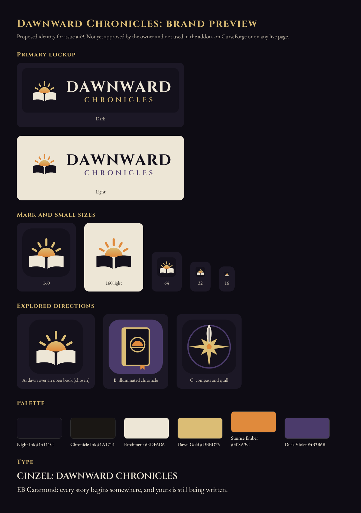

# Dawnward Chronicles: brand guide (proposal, #49)

> **Status: proposal awaiting the owner's approval.** Nothing here replaces branding on any live service yet: not the addon UI, not CurseForge, and not a published website. The README and site drafts use these assets on a review branch only.

## The idea
**Dawn over an open book.** A sun rises out of a chronicle's pages: a story that is still being written, and a character who keeps becoming. The name already says "dawn"; the book says "chronicle". The mark is two flat shapes and a half disc, so it still reads at 32 px.

### Directions explored
| Direction | Idea | Verdict |
|---|---|---|
| **A: dawn over an open book** | The sun rises from the pages; rays fan above | **Chosen.** Says both halves of the name, stays legible at 16–32 px, and matches the addon's Neutral theme |
| B: illuminated chronicle | A closed tome with a dawn medallion and ribbon | Handsome, but at small sizes it reads as a generic book or app icon, and the sun is lost |
| C: compass and quill | An eight-point star whose north point is a quill nib | Strong at large sizes, but says "map or exploration addon" more than "your character's story", and is too detailed at 16 px |

Sources: `assets/branding/concepts/`.

## Assets
| Use | File |
|---|---|
| Primary lockup, dark / light | `assets/branding/svg/dawnward-lockup-dark.svg`, `…-light.svg` (PNG: `png/dawnward-lockup-*.png`, 989 × 280) |
| Lockup without a background (for coloured pages) | `svg/dawnward-lockup-dark-transparent.svg` (light text), `…-light-transparent.svg` (dark text) |
| Square mark / avatar | `svg/dawnward-mark-dark.svg`, `…-light.svg`; PNG 1024, 512, 400, 256, 128, 64 (`png/dawnward-icon-*.png`) |
| Favicon | `svg/favicon.svg`, `png/favicon-32.png`, `png/favicon-16.png`, `png/apple-touch-icon-180.png` |
| Social preview (GitHub) | `png/social-preview-1280x640.png` |
| Wide banner (CurseForge description or header) | `png/curseforge-banner-1920x480.png` |
| Preview sheet | `previews/branding-preview.png` |

Check each platform's current image requirements at upload time. The sizes here are common choices, not confirmed requirements.

## Palette
| Name | Hex | Use |
|---|---|---|
| Night Ink | `#14111C` | Dark backgrounds |
| Chronicle Ink | `#1A1714` | The addon's Neutral window; matches `Core/Themes.lua` |
| Parchment | `#EDE6D6` | Light backgrounds, and text on dark |
| Dawn Gold | `#DBBD75` | Accents, headings and rays (the addon's Neutral accent) |
| Sunrise Ember | `#E08A3C` | The sun's lower edge and highlights. **Not for text on Parchment** (2.2:1) |
| Dusk Violet | `#4B3B6B` | Secondary accent, and the subline on light |

Contrast (WCAG): Parchment on Night Ink 15.0:1; Dawn Gold on Night Ink 10.3:1; Night Ink on Parchment 15.0:1; Dusk Violet on Parchment 7.9:1; Sunrise Ember on Night Ink 7.0:1.

## Typography
- **Cinzel** (700 for DAWNWARD, 600 with wide tracking for CHRONICLES) in the wordmark. The wordmark is converted to vector outlines in the SVGs, so no font is needed to display it.
- **EB Garamond** for body text on the site and banners.
- Both are under the SIL Open Font License 1.1 (Google Fonts), which allows commercial use, embedding and modification.

## Usage
- Keep clear space around the mark equal to the sun's radius. Don't stretch, recolour outside the palette, add effects, or put the dark lockup on light backgrounds.
- At 32 px and below, use the mark alone, never the lockup.
- Never pair the mark with Blizzard, World of Warcraft or Total RP 3 logos in a way that suggests endorsement. "Built to complement Total RP 3" is text, not a logo pairing.

## Provenance
- All shapes are hand-written geometry in `tools/branding/build.py`. Nothing was traced, scraped, taken from game files, or generated by an image model.
- PNGs are rendered from those SVGs with Chromium (Playwright) by the same script: `python tools/branding/build.py --font-dir <Cinzel dir> --png`.
- The fonts are not committed. Download Cinzel from Google Fonts to rebuild.
