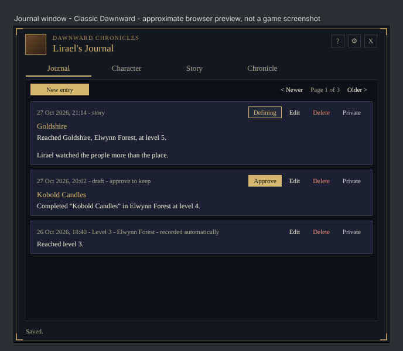
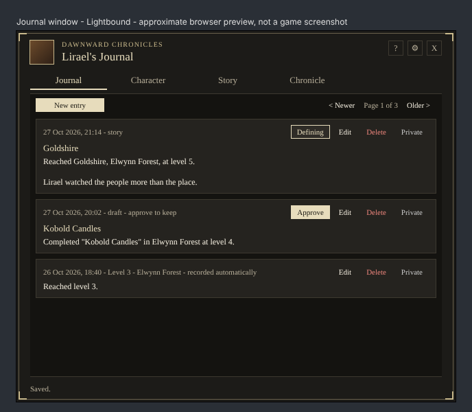
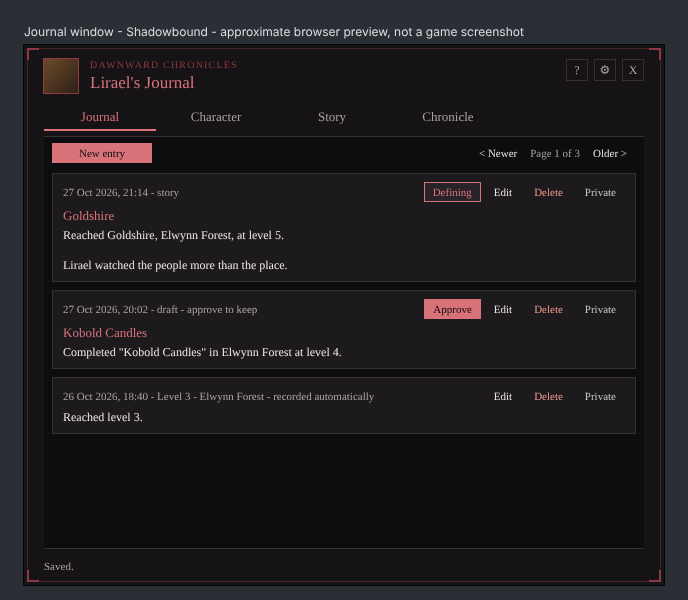
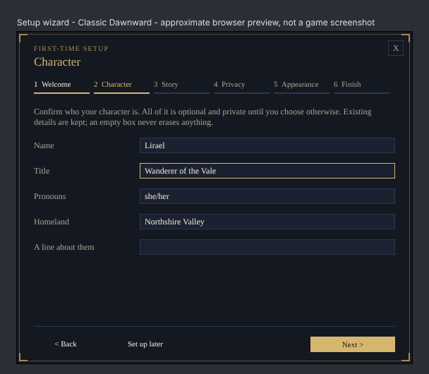
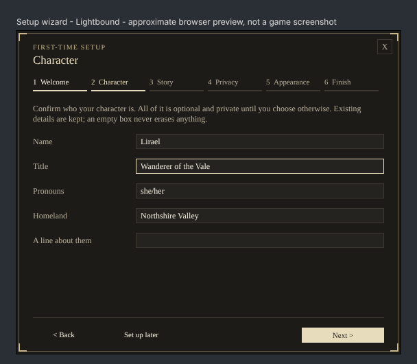
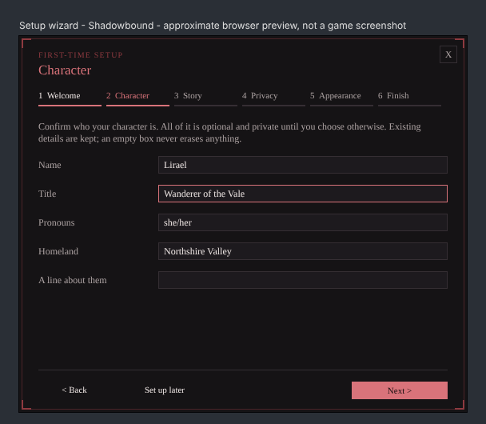

# Dawnward Chronicles v0.6: UI design specification

Status: **implemented on `feat/v0.6-ui-overhaul`** (automated tests only; not yet verified in game).
Baseline: v0.5.0-dev, schema 5, Classic Era 1.15.9 (interface 11509), Lua 5.1.

v0.6 is a visual and onboarding release. No gameplay rules change, and every v0.5 feature stays reachable.

---

## 1. Audit of the v0.5 interface

| Area | v0.5 implementation | Problems found |
|---|---|---|
| Window chrome (`MainWindow`) | Blizzard `UI-DialogBox-Border` backdrop, stock `UIPanelCloseButton`, square icon textures for help and settings, text tabs with an underline | The dialog border reads as 2004-era stock UI. Icons, tabs and close button are three unrelated styles. There is no header hierarchy |
| Buttons (`Widgets.Button`, used ~150 times) | `UIPanelButtonTemplate` (red and gold Blizzard buttons) | Heavy and loud. Every button has the same weight, so primary and destructive actions look alike. Labels are truncated at 58–64 px |
| Inputs (`Widgets.EditLine`, `TextArea`) | `InputBoxTemplate`, and a black well | Inconsistent. The line inputs use Blizzard art, the text areas a flat black box |
| Colours | `Core/Themes.lua` has 6 roles (background, panel, text, muted, accent, border). Most colouring is hand-written in each module's `ApplyTheme`; `CopyBox` and `ReactionCard` hard-code their own | The same colour logic is repeated in 9 modules. Buttons, inputs and separators are not themed at all |
| Confirmations (`Widgets.Confirm`) | Blizzard `StaticPopup` | Breaks the visual language. Ten call sites |
| Journal | Free-floating text rows, a separator line, 4 Blizzard buttons per row | Rows don't read as entries. The 26 px "*" button is cryptic |
| Character | Label/value rows, Edit and visibility buttons | Acceptable structure, but no grouping |
| Story | Answers are full-width red Blizzard buttons | The most important screen looks like a list of warnings |
| Chronicle | 7 sub-tabs as 76 px Blizzard buttons, two-line rows | Sub-tabs look like actions, not navigation |
| Settings | One long hand-placed page (theme, backup, simulation, minimap, guide, 9 story cycles, TRP3) | Crowded. Nothing is grouped; placement is by y-offsets that collide easily |
| Guide | Overlay with Blizzard buttons | It is also the first-run experience, which it was never designed to be |
| Reaction card, copy window | Their own colours and borders | Visually separate from the window |
| First run | The guide opens once | Nothing is set up: no name, prompt preferences, privacy explanation or theme |

---

## 2. Navigation structure

```
┌───────────────────────────────────────────────────────────────┐
│ [▣] DAWNWARD CHRONICLES                         [?] [⚙] [×]   │ header (52)
│     Lirael's Journal                                          │
│  Journal   Character   Story   Chronicle                      │ primary nav (28)
├───────────────────────────────────────────────────────────────┤
│                                                               │
│                        content area                           │
│        sections may add a secondary nav (segmented)           │
│                                                               │
├───────────────────────────────────────────────────────────────┤
│ status line                                                   │ footer (28)
└───────────────────────────────────────────────────────────────┘
```

- **Primary sections (unchanged, four):** Journal, Character, Story, Chronicle.
- **Secondary navigation:** a segmented control inside a section, never more top-level tabs.
  - Chronicle: Memories · Arcs · Goals · Stances · People · Places · Review.
  - Settings: General · Story · Data · Total RP 3.
- **Header actions:** **?** opens the guide (contextual help), **⚙** toggles Settings, **×** closes the window. Settings and the guide replace the content area; they are not sections.
- **Setup wizard:** its own window. It opens instead of the journal the first time a new character uses Dawnward, and **Finish** opens the journal.
- **Overlays inside the window:** forms, editors and the guide cover the content area only, so the header and navigation stay visible and the window never jumps.
- **Dialogs:** confirmations are a Dawnward-styled modal at DIALOG strata, closed with Escape.

---

## 3. Visual system

### 3.1 Colour tokens (per theme, all `{ r, g, b }`)
| Token | Use |
|---|---|
| `background` | Window body: header, navigation, footer |
| `panel` | Content area (all reading text sits here) |
| `surface` | Raised elements on the panel: cards, rows, buttons, inputs |
| `surfaceHover` | Hovered surface |
| `edge` | 1 px borders of surfaces and dividers |
| `ornament` | Frame line and corner accents (restrained antique gold, or the theme's accent metal) |
| `text` | Body text |
| `muted` | Labels, meta lines, hints |
| `accent` | Headings, the selected navigation item, focus rings |
| `accentText` | Text on an accent-filled (primary) button |
| `danger` | Destructive buttons' text and edge |
| `border` | Legacy tint (kept for v0.5 code that still reads it) |

**Contrast rules (tested):**
- `text`, `muted` and `accent` reach at least 4.5:1 on `background`, `panel` and `surface`.
- `accentText` reaches at least 4.5:1 on `accent`.
- `danger` reaches at least 4.5:1 on `surface`.
- The visibility colours (Public, Private, Secret) reach at least 4.5:1 on `panel` and `surface`.

### 3.2 Themes (cosmetic, per character, never chosen from class, race or faction)
| ID | Name | Character |
|---|---|---|
| `dawnward` | **Classic Dawnward** (new default) | Charcoal and deep navy, antique-gold accents |
| `lightbound` | **Lightbound** | Warm charcoal, muted ivory and pale-gold accents |
| `shadowbound` | **Shadowbound** | Charcoal, restrained crimson accents |
| `neutral` | Neutral (v0.2) | Kept for existing characters |
| `silverhand` | Silver Hand (v0.2) | Kept |
| `arcane` | Arcane (v0.2) | Kept |

- The three v0.2 themes stay valid: a saved `char.theme` is never changed.
- New characters start on Classic Dawnward.
- The TRP3 presentation styles (`trp3Style`) are a separate setting and are untouched.

### 3.3 Typography
Only the client's own font objects (Friz Quadrata), with no shipped fonts:

| Role | Font object | Colour |
|---|---|---|
| Window title / wizard step title | `GameFontNormalLarge` | `accent` |
| Eyebrow (small caps line above the title) | `GameFontNormalSmall` | `ornament` |
| Heading | `GameFontNormal` | `accent` |
| Body | `GameFontHighlight` | `text` |
| Meta, label, hint | `GameFontHighlightSmall` | `muted` |

### 3.4 Spacing and sizes
- **Spacing scale:** 4 · 8 · 12 · 16 · 24 (`Style.SPACE`).
- **Controls:**
  - buttons 22 px high (compact 20 px);
  - primary nav 28 px;
  - segmented control 22 px;
  - inputs 22 px;
  - icon buttons 22 × 22.
- **Corners:** square, and the frame keeps the Warcraft feel through ornament, not rounding.
- **Window:** 640 × 540 UI units. On small screens it scales down (`MainWindow.FitScale`) so it always fits UIParent with a margin, and it stays clamped to the screen.
- **Wizard:** 560 × 470.

### 3.5 Frame chrome (`Style.Chrome`)
1. A solid `background` fill. It is fully opaque, as the v0.1 readability rule requires.
2. An outer 1 px near-black line.
3. An inner 1 px `ornament` line, inset 3 px, at reduced alpha.
4. Four corner brackets: two 10 px `ornament` strokes per corner, at full alpha.

Everything is built from solid-colour textures. No art files ship and no Blizzard border art is used, so every theme recolours the frame completely.

### 3.6 Components (`UI/Style.lua`, `UI/Widgets.lua`)
| Component | Variants and states |
|---|---|
| `Widgets.Button(parent, text, w, h, variant)` | `default` (surface), `primary` (accent fill), `ghost` (no fill until hovered), `danger` (danger text and edge). States: normal, hover (lighter fill, accent edge), pressed (1 px text offset), disabled (muted text, no hover) |
| `Widgets.IconButton` | 22 × 22 glyph buttons ("X" to close, "<" and ">") with hover. The window header's ? and settings buttons hold the game's own question-mark and gear icons, desaturated and tinted with the theme (muted, accent on hover) |
| `Widgets.Tabs` / `Widgets.Segmented` | Primary nav: text with a 2 px accent underline for the selected item and hover colour. Segmented: joined surface buttons, the selected one filled |
| `Widgets.EditLine`, `Widgets.TextArea` | Surface-coloured well with a 1 px edge; the accent edge shows while focused |
| `Widgets.Card` | Surface fill and 1 px edge, for journal entries and choices |
| `Widgets.Divider` | 1 px `edge` line |
| `Widgets.Label(parent, font, wrap, role)` | `role` = title, eyebrow, heading, body, muted, accent. Coloured automatically |
| `Widgets.Confirm` | Dawnward modal: heading, text, Cancel (default) and an accept button in the `danger` variant. Escape cancels |
| `Style.Chrome(frame)` | The frame treatment above, used by the window, wizard, dialog, reaction card and copy window |

**Theming mechanism:**
- Components register with `Style.Register(object, painter)`.
- `Style.Apply(theme)` repaints every registered object, and a newly created component is painted with the current theme at once.
- Modules no longer hand-colour buttons, inputs or chrome.
- Their remaining `ApplyTheme` methods only colour labels whose role changes with state.

**Hover without breaking tooltips:** state changes use `HookScript`, and `Widgets.Tooltip` uses `HookScript` too, so a tooltip never removes the hover style.

---

## 4. Screens

| Screen | v0.6 treatment |
|---|---|
| Journal | Each entry is a card: meta (muted) · title (accent) · body. Actions are ghost buttons on the card's top line: ★ Defining, Approve (primary when shown), Edit, Delete (danger), visibility. A toolbar holds New entry (primary) and pager controls |
| Character | Grouped headings (Profile, Family, History) on dividers. Field rows: label column, value, Edit (ghost), visibility. Add buttons are primary |
| Story | Summary strip. The question as a heading, with context in muted text. Answers are left-aligned choice cards (surface, hover accent edge). "In your own words" input with Save. Later, Not now (ghost) and Dismiss (danger, ghost). Pending changes are cards with Approve (primary) and Reject |
| Chronicle | Segmented sub-navigation. Two-line rows as in v0.5 (#46 rules kept): primary actions as ghost buttons, Remove as danger. A New button (primary) and pager |
| Settings | Segmented: **General** (theme gallery with swatches, minimap button, guide, run setup), **Story** (prompt settings), **Data** (backup, import, simulation), **Total RP 3** (read-only status and how to opt in) |
| Guide | Same overlay, restyled; topics as a vertical segmented list |
| Forms | Same `Forms` API, with the new inputs and buttons; Save is primary, Remove is danger |
| Reaction card | Chrome, eyebrow "A moment for your story", question, Answer (primary), Later, Dismiss (ghost) |
| Copy window | Chrome and the new buttons; the v0.1 layout table and its tests are unchanged |

---

### 4.1 Approximate previews
Browser renderings built from the same theme colours and layout sizes (`python tools/design/render_previews.py`). **They are not game screenshots.** The game uses Friz Quadrata and its own text rendering, so verify against the real client with TESTING.md part N.

| | Classic Dawnward | Lightbound | Shadowbound |
|---|---|---|---|
| Journal |  |  |  |
| Setup wizard |  |  |  |

---

## 5. First-time setup wizard

### 5.1 Stages
| # | Stage | Contents | Defaults |
|---|---|---|---|
| 1 | Welcome | What Dawnward is; complements TRP3; private by default; about two minutes, everything changeable later | — |
| 2 | Character | Name, Title, Pronouns and Homeland (one line each), and "About them" (Summary) in a text area at its full stored size (2,000 bytes, line breaks kept). All optional | Name pre-filled with the in-game name as a suggestion. Existing values pre-filled |
| 3 | Story preferences | How often (rare, normal, frequent, off), Place moments (on, fewer, off), Moment card (on, off), Personality changes (ask, auto) | The character's current prefs, or `StorySchema.DEFAULT_PREFS` |
| 4 | Privacy | Explains private, secret and public. Explains that Total RP 3 sync is off and stays off unless enabled later with `/dawnward trp3`. Shows read-only TRP3 detection | No toggles that publish or sync |
| 5 | Appearance | Theme gallery (live preview), minimap button on or off | Current theme, or Classic Dawnward |
| 6 | Finish | Review of every choice, and what Finish will write | — |

**Navigation:**
- Back, Next, Finish, Close (×) and "Set up later".
- A step indicator: six numbered pips with labels.
- Values are kept in a draft table while moving between pages.

### 5.2 Rules
- **Auto-launch:** only when the player opens Dawnward (`/dawnward`, the minimap button or a reaction card) for a character that is **new** (`Onboarding.IsEstablished(char, now)` is false). The wizard is also not completed, it hasn't been auto-shown this session, simulation mode is off, and the saved data is writable.
- **Established characters:**
  - Anything the player wrote or answered counts at once: a profile field, a personality value, family, history, a fact, their own journal entry, a decision, memory, arc, goal, stance or person.
  - Data Dawnward recorded by itself (automatic level-up entries, story events, places) counts once the record is more than **7 days** old. So a fresh character that levelled up before first opening Dawnward still gets the wizard, and an old record never does.
  - Established characters never see the wizard automatically. Settings → General → **Run setup** (or `/dawnward setup`) opens it on demand.
- **Close, Escape or "Set up later":** saves the draft. "Set up later" also opens the journal. The next session, the wizard resumes on the same page. Completion is not marked.
- **Drafts and Finish hold only what the player changed** (each box is compared with what it was filled with). Everything else is read fresh from the character, so a setting changed elsewhere after a draft is never undone, and an untouched long Summary is never rewritten.
- **Finish:**
  - creates the character record if needed;
  - writes only fields whose value is non-empty and differs from the saved one (it never clears or overwrites with an empty value);
  - writes the chosen prefs and theme, and the minimap setting;
  - marks `wizard.done = true` with the version and time;
  - clears the draft and opens the journal.
- **TRP3:** never written, enabled or synced.
- **Read-only saved data or simulation mode:** the wizard opens as a preview that cannot save and keeps no draft, so real and test data never mix.
- **Confirmations:** Escape cancels only the dialog (keyboard handler), not the journal or wizard beneath it.

### 5.3 Saved state (no schema bump)
- Per character: `char.wizard`, reserved since schema 3 and so far always `{}`. It becomes `{ done, version, doneAt }`, cleaned by `Onboarding.Clean` (unknown keys dropped, so `{ step = 3 }` still cleans to `{}`).
- Drafts, account-wide by character key: `DawnwardChroniclesDB.ui.wizardDrafts[characterKey] = { page, values }`. They live here so an unfinished wizard never creates a character record (and so never starts story recording) before Finish. They are cleaned in `Schema.NormalizeUi`, capped at 50 characters, and values are length-limited.
- Both are additive. Schema stays at 5, so older v0.5 builds ignore them, and normalising drops nothing they need.

### 5.4 Test mode (`/dawnward dev setup`)
- The title bar reads "PREVIEW — test mode". It is pre-filled from the character's current data, and its draft is kept in memory only.
- The Finish page shows **Close preview** (discards) and **Save choices** (applies fields, prefs, theme and minimap only after an explicit click).
- Test mode never changes `wizard.done`, `version` or the real draft.

---

## 6. Developer commands (development builds only)
- **Gating:**
  - Enabled when the addon version contains `-dev` (from the TOC; `0.6.0-dev` now). Release builds answer "Developer commands are only available in development builds."
  - `tools/package.py` prints a note whenever it packages a `-dev` build, so a release is never shipped with them enabled by mistake.
- **Commands:**
  - `/dawnward dev setup`: the wizard in test mode, even if completed.
  - `/dawnward dev setup status`: complete or not, wizard version, completion date, whether a draft exists (and its page), and whether the character counts as established.
  - `/dawnward dev setup reset`: explains what will be reset and asks for `/dawnward dev setup reset confirm`. It then clears only `char.wizard` and this character's draft. It never touches fields, journal, story, memories, goals or any other data.

---

## 7. Migration and data safety
- Schema stays at **5**. All new persisted values (`char.wizard` contents, `ui.wizardDrafts`) are additive and cleaned on load.
- Theme IDs: the three new IDs are added and the three old ones kept. `Themes.DEFAULT` becomes `dawnward` for new characters only. An unknown saved ID still falls back to the default.
- SavedVariables are never erased. Read-only loads stay read-only, and the wizard cannot save into them.
- TRP3 stays optional, and the wizard never writes to TRP3.

## 8. Phased implementation plan
1. **Design system:** `Style` (tokens, registry, chrome), new themes with contrast tests, component kit in `Widgets` (buttons, icon buttons, inputs, tabs, segmented, card, divider, confirm dialog).
2. **Window shell:** header, primary nav, footer, fit-to-screen scaling.
3. **Screens:** Journal, Character, Story, Chronicle, Settings (segmented), Guide, Forms, reaction card, copy window.
4. **Onboarding:** `Core/Onboarding.lua` (state, established check, draft cleaning, apply), `UI/SetupWizard.lua`, auto-launch hook, guide no longer auto-opens.
5. **Developer commands:** `Core/DevCommands.lua`, gated, with tests.
6. **Validation:** check.py, packaging, TESTING.md v0.6 section, docs.

## 9. Known limitations
- Scroll bars still use the stock `UIPanelScrollFrameTemplate` art. Restyling Blizzard's scroll bar safely across clients is left for later.
- Mock-based tests prove wiring and layout maths, not real rendering. Every visual claim needs the v0.6 in-game checklist (TESTING.md, part N).
- Glyphs: Friz Quadrata lacks many symbols, so text glyphs are ASCII only ("X", "<", ">"). The header's help and settings buttons use the game's own icons, desaturated and tinted.
- Mock tests now fire OnShow and OnHide like the client. That exposed one build-time OnHide in the wizard, which is fixed.
